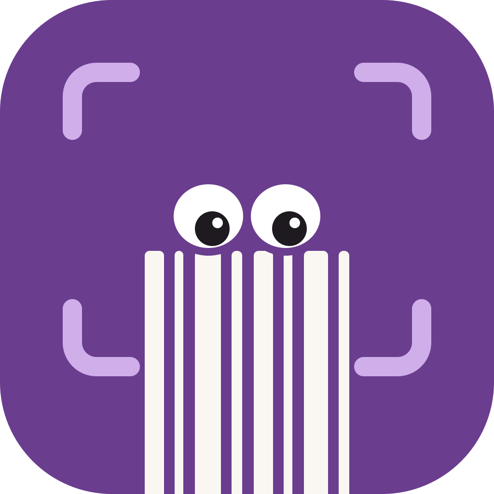
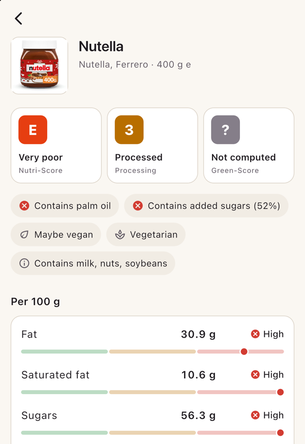
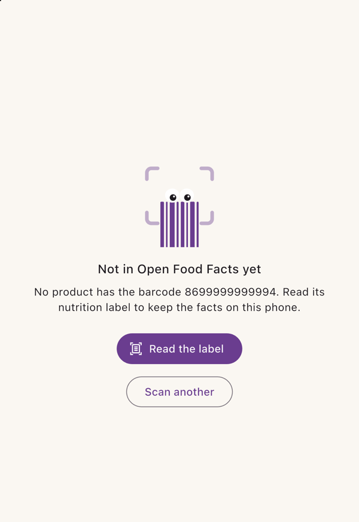
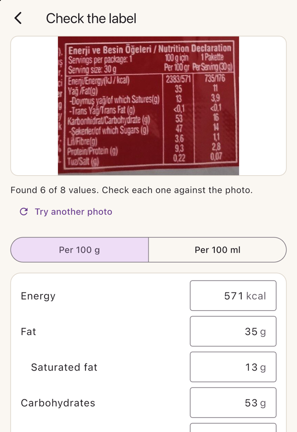
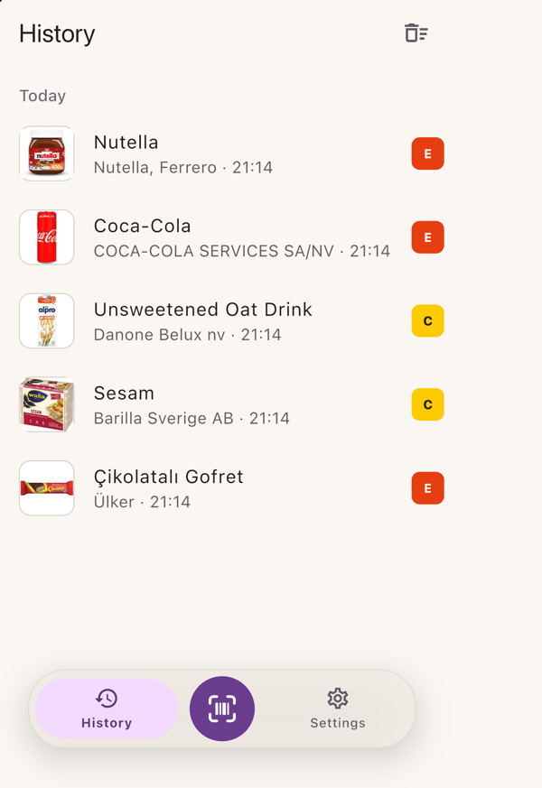
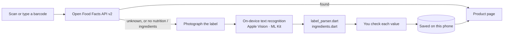

<div align="center">



# Morsel

**Scan food, see what's in it.**

Scan a barcode to see how healthy a food is, or photograph a nutrition label and read it on
the phone. One Flutter codebase for iOS, Android and the web.

[](https://flutter.dev)
[](#getting-started)
[](https://world.openfoodfacts.org)
[](LICENSE.md)

[Features](#features) · [How it works](#how-it-works) · [Getting started](#getting-started) ·
[Tests](#tests) · [Docs](#documentation) · [License](#license)

<table>
  <tr>
    <td align="center"><br><sub>Answer first</sub></td>
    <td align="center"><br><sub>Not found? Read the label</sub></td>
    <td align="center"><br><sub>Check what was read</sub></td>
    <td align="center"><br><sub>History, on the device</sub></td>
  </tr>
</table>

<sub>iOS simulator. Product and label photos from Open Food Facts, CC BY-SA.</sub>

</div>

## Features

- **Scan a barcode, get an answer.** EAN-13, EAN-8, UPC-A and UPC-E. The product page leads
  with Nutri-Score, processing (NOVA) and Green-Score, then shows fat, saturated fat, sugars
  and salt on meters against Open Food Facts' thresholds.
- **Ingredients and allergens.** The ingredient list with allergens in bold, palm oil and added
  sugars flagged, vegan and vegetarian shown as facts, and Open Food Facts' own explanation of
  every score.
- **Read the label.** When Open Food Facts doesn't know a product, or has no nutrition facts or
  ingredients for it, photograph the label. Text recognition runs on the phone, reads the
  per 100 g column in seven languages, picks out the ingredient list and finds the EU's 14
  allergens. You check every value against the photo before it's saved.
- **Private by default.** No account, no backend. History and saved labels stay on the device;
  the only thing that leaves the phone is the Open Food Facts lookup.
- **No dead ends.** No camera? Type the barcode. Not found? Read the label. Deleted a scan? Undo.
- **Light and dark.** A plum & oat palette, with every text colour measured to WCAG AA.

### How well it reads

Measured on Open Food Facts label photos (`test/fixtures`), with Apple Vision on a Mac:

| | Photos | Result |
|---|---|---|
| Nutrition tables | 24 | 116 of 147 values right, 2 wrong; most of the rest not recognised at all |
| Ingredient lists | 39 | 24 of 31 lists at least 90 % alike to the label, 5 roughly, none wrong |
| Allergens | the 31 lists | 107 of 121 found, none invented |

The corpus tests hold every recogniser to at least 75 % of values right and at most 5 % wrong:
an empty field costs some typing, a wrong one costs trust. More in
[docs/ARCHITECTURE.md](docs/ARCHITECTURE.md).

## How it works



A saved label fills in only what Open Food Facts lacks. The document scanner, text recognition
and photo cut-out go through a small platform channel of Morsel's own, `morsel/vision`, rather
than plugins.

| Capability | Built on | iOS | Android | Web |
|---|---|---|---|---|
| Barcode scanning | `mobile_scanner` | Apple Vision | ML Kit | ZXing |
| Product data | Open Food Facts API v2 | ✓ | ✓ | ✓ |
| Label scan, text recognition, cut-out | `morsel/vision` | Apple Vision, VisionKit | ML Kit | — |
| Photo picking | `image_picker` | ✓ | ✓ | — |
| Settings and history | `shared_preferences` | ✓ | ✓ | ✓ |

## Getting started

You need a [Flutter SDK](https://docs.flutter.dev/get-started/install) with Dart 3.13.5 or
newer (Morsel is built on Flutter 3.47.7), plus Xcode for iOS, or the Android SDK and JDK 21
for Android. No CocoaPods: iOS plugins resolve through Swift Package Manager.

```sh
git clone https://github.com/aslansutu/morsel.git
cd morsel
flutter pub get
flutter devices                # list device ids
flutter run -d chrome          # web: type a barcode, or scan with the webcam
flutter run -d <device-id>     # a phone over USB, or a simulator
```

> [!NOTE]
> **iOS.** If `xcode-select` points at the Command Line Tools rather than Xcode, prefix iOS
> commands with `DEVELOPER_DIR=/Applications/Xcode.app/Contents/Developer`. On a real iPhone,
> choose your own team in `ios/Runner.xcworkspace` → Runner → Signing & Capabilities. The
> simulator has no camera, so choose a photo instead of using the document scanner; add one
> with `xcrun simctl addmedia booted <image>`.

> [!TIP]
> Barcodes to try: `3017620422003` (Nutella), `5449000000996` (Coca-Cola), and
> `8699999999994`, which Open Food Facts doesn't have, so you can try *Read the label*.

### Build

```sh
flutter build apk --release --target-platform android-arm64   # Android, signed with the debug key
adb install -r build/app/outputs/flutter-apk/app-release.apk  # -r keeps the app's data
flutter build web --no-wasm-dry-run                            # web
```

## Tests

```sh
flutter analyze
flutter test                                                  # unit and widget tests, no network
flutter test integration_test -d <device-id>                  # live Open Food Facts lookups
flutter test integration_test/label_test.dart -d <device-id>  # the phone's text recognition on real labels
```

`flutter test` needs no network and no device: Open Food Facts and the phone's text recognition
are faked. Every test has its reason written down in [docs/TESTING.md](docs/TESTING.md).

> [!WARNING]
> Integration tests launch the app, and the test runner may uninstall it afterwards. That
> deletes the history and saved labels on that device.

## Project layout

```
lib/
├── main.dart              app shell and the floating dock (History · Scan · Settings)
├── scanner_screen.dart    camera scanning and the type-a-barcode sheet
├── off_client.dart        Open Food Facts lookups
├── panels.dart            Open Food Facts' knowledge panels
├── product_screen.dart    the product page
├── label_parser.dart      recognised text → nutrition values
├── ingredients.dart       recognised text → ingredient list and allergens
├── label_screen.dart      the review form
├── labels.dart            saved labels on the device
├── vision.dart            the morsel/vision channel
└── …                      history, settings, theme, brand
ios/Runner/AppDelegate.swift                                        Apple Vision, VisionKit
android/app/src/main/kotlin/dev/atakanonol/morsel/LabelVision.kt    ML Kit
test/fixtures/             recognised text of real label photos, with the true values
tool/brand_icons.py        every app icon, drawn from one geometry
```

## Documentation

| | |
|---|---|
| [ARCHITECTURE.md](docs/ARCHITECTURE.md) | Stack, data flow, Open Food Facts API facts, how label reading works and how well it reads |
| [DESIGN.md](docs/DESIGN.md) | Palette, contrast, UI and UX rules, every screen, the logo |
| [TESTING.md](docs/TESTING.md) | Test rules and why each test exists |
| [ROADMAP.md](docs/ROADMAP.md) | What's done, what's next, decisions still open |

## Roadmap

Next is an optional on-device model (Gemma 4 E2B) for labels that text recognition alone can't
read. Later: Apple's built-in model on iPhones that have it, and sending what you read to Open
Food Facts. Details in [docs/ROADMAP.md](docs/ROADMAP.md).

## License

Morsel is source-available under the [PolyForm Noncommercial License 1.0.0](LICENSE.md). You
may use, study, change and build it for any noncommercial purpose, such as personal use, study
or a hobby project. You may not sell it or use it for any commercial purpose. It is not an
OSI-approved open-source license; read [LICENSE.md](LICENSE.md) for the full terms.

Product data comes from [Open Food Facts](https://world.openfoodfacts.org) under the
[Open Database License](https://opendatacommons.org/licenses/odbl/1-0/), and product photos
under CC BY-SA. Morsel isn't affiliated with Open Food Facts.
